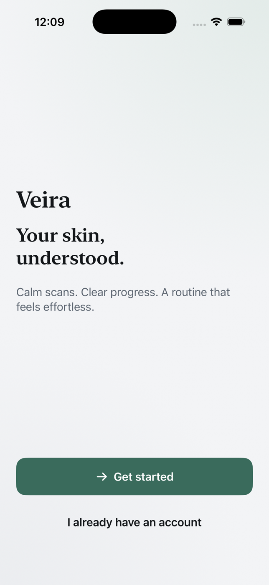

# Veira

[](https://github.com/Mubarakjk/veira/actions/workflows/ci.yml)

A skincare and wellness app for iPhone, written in Swift 6 and SwiftUI. Scan your skin, follow a daily routine and watch your progress over time.



## Status

This repository is the app's foundation: the full navigation, all ten screens, the design system, networking, storage and in-app purchases. The screens currently show sample data. Real skin analysis and a live backend are the next stage, and the code is structured so they slot in without changing the screens.

## What's in the app

| Screen | What it does |
| --- | --- |
| Splash, Welcome, Onboarding | First-run flow |
| Sign in / Create account | Session handling with tokens stored in the Keychain |
| Permissions | Explains camera and notification access before asking |
| Home | Today's skin score and what to do next |
| Scan | Capture flow: ready, capturing, analysing, result |
| Progress | Weekly score history |
| Routine | Morning and evening steps with completion tracking |
| Settings | Account, subscription and preferences |

## Architecture

The app is split into six Swift packages. Dependencies only point downwards, so a screen can never reach into the network or the Keychain directly.

```
Veira (app)
├── VeiraDesignSystem    colours, type, spacing, reusable components
├── VeiraDomain          models and repository protocols
├── VeiraData            Keychain, storage, API client, repositories
│   └── VeiraNetworking  HTTP client, endpoints, interceptors, retry
├── VeiraStoreKit        StoreKit 2 purchases and entitlements
└── VeiraCore            logging, analytics, environment, dependency injection
```

More detail is in [Documentation/ARCHITECTURE.md](Documentation/ARCHITECTURE.md).

### Decisions I made

- **Screens depend on protocols, not implementations.** A screen asks for a `SessionRepository`. Whether that is the real Keychain-backed one or a mock is decided in one place, `AppContainer`. This is what makes the screens testable and previewable.
- **One place builds everything.** `AppContainer` is the only file that creates concrete types. There are no global singletons.
- **Navigation is data.** `AppRouter` holds the current flow, tab and stack as plain values, so navigation can be unit tested without launching the app.
- **The network layer retries sensibly.** Temporary failures (a dropped connection, a 503) are retried with exponential backoff. Permanent ones (a 400) are not. An expired token is refreshed once and the request repeated, and a second 401 stops instead of looping.
- **Errors shown to users never leak technical detail.** Every network error maps to a plain sentence, and a test checks that no status codes or internal names appear in them.
- **Strict concurrency.** The project builds with Swift 6's complete concurrency checking. Shared state lives in actors.
- **Accessibility from the start.** Dynamic Type is supported, and animations respect Reduce Motion.

## Run it

You need Xcode 16 or newer and [XcodeGen](https://github.com/yonaskolb/XcodeGen).

```bash
brew install xcodegen
git clone https://github.com/Mubarakjk/veira.git
cd veira
./Scripts/generate-project.sh
open Veira.xcodeproj
```

Pick the **Veira** scheme and an iPhone simulator, then press Run.

The Xcode project file is generated from `project.yml`, so it is not committed. That avoids merge conflicts in the project file.

## Tests

```bash
swift test --package-path Packages/VeiraNetworking
```

57 tests in total: 51 across the packages and 6 for app navigation.

| Package | Tests | What they cover |
| --- | --- | --- |
| VeiraNetworking | 28 | Retries, token refresh, request building, interceptors, error classification |
| VeiraDomain | 15 | Score clamping and bands, routine progress, session expiry |
| VeiraCore | 4 | Environment and dependency injection |
| VeiraData | 2 | Session storage |
| VeiraStoreKit | 2 | Entitlement mapping |
| App | 6 | Navigation router |

The networking tests run the real `URLSession` client against a stub that replays canned responses, so the retry and refresh logic is tested end to end without a network.

GitHub Actions runs the package tests and builds the app on every push.

## Next steps

- Camera capture and real skin analysis behind the existing `Scan` flow
- A live backend in place of the sample data
- More tests for `VeiraData` and `VeiraStoreKit`

## Tech

Swift 6, SwiftUI, Swift Package Manager, StoreKit 2, XcodeGen, XCTest and GitHub Actions.
